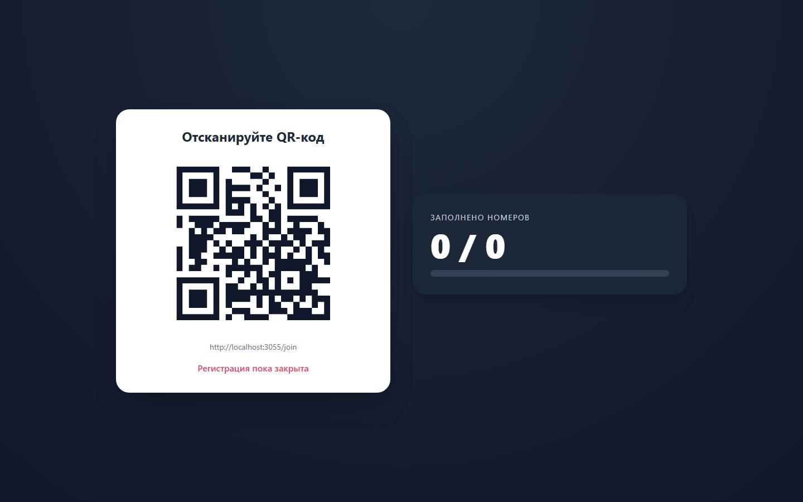
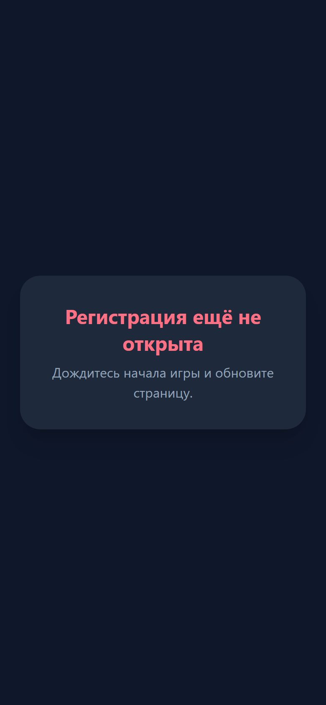
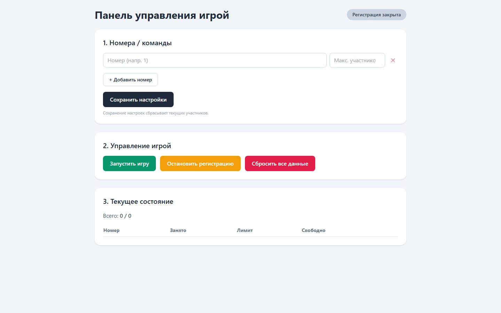

# QR Number Game — Random Numbers for Event Participants

A small real-time app for live events: the organizer shows one QR code on a big screen, everyone scans it with their phone and instantly gets a random number (team, table, turn order), while the screen shows how many places are filled.

<p>
  
  
</p>

## How it works

1. **Organizer** (`/admin`) defines the numbers and how many people each one can take, then opens registration.
2. **Big screen** (`/display`) shows the QR code and a live "filled / total" counter.
3. **Participants** (`/join`) scan the code and get a random number among those that still have free places. The number is remembered on the phone, so reloading the page doesn't hand out a second one.
4. The organizer can stop registration or reset the round; every open page updates instantly.



## Tech

- **Node.js + Express** — REST API for joining and admin actions
- **Socket.IO** — pushes state to every screen in real time (polling fallback in the admin panel)
- **qrcode** — generates the join QR from the server's own public URL
- Plain HTML/CSS/JS pages, no build step; state is kept in memory for the duration of an event

```
server.js        API, game state, Socket.IO broadcasting
public/
├── display.html Big screen: QR + live counter
├── join.html    Participant page
└── admin.html   Organizer panel
```

## Run locally

```bash
npm install
npm start        # http://localhost:3000/display
```

## Notes

The admin panel has no login yet: it is meant for a single organizer during a live event. Adding a password is the next step before using it in public.
